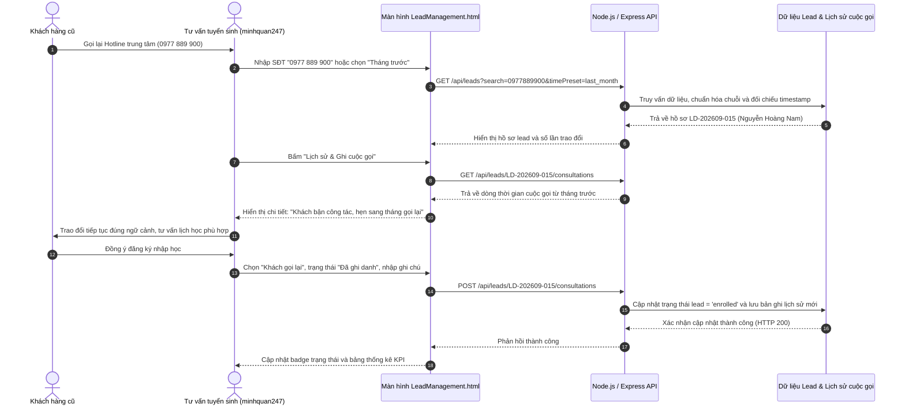

# Hệ Thống Quản Lý Đào Tạo & Tuyển Sinh (Training Management System - TMS)

[](https://github.com/azmedia2006/K15C6_N4)
[](https://github.com/azmedia2006/K15C6_N4/tree/feature/KN_76)
[](https://github.com/minhquan247)
[](https://github.com/azmedia2006/K15C6_N4)
[](file:///c:/Users/Administrator/Downloads/minhquan_ttcs/backend/test/lead_filter_kn76.test.js)

---

## 1. Tổng Quan Dự Án

Hệ thống Quản lý Đào tạo (TMS - Training Management System) là giải pháp phần mềm quản trị toàn diện hoạt động vận hành đào tạo và tuyển sinh của trung tâm. Hệ thống kết nối và phục vụ 8 nhóm tác nhân nghiệp vụ: Khách truy cập, Học viên, Giảng viên, Trợ giảng, Tư vấn tuyển sinh, Kế toán đào tạo, Quản lý đào tạo và Quản trị hệ thống.

Mục tiêu cốt lõi của hệ thống là thiết lập một nguồn dữ liệu tập trung duy nhất (**Single Source of Truth**), thay thế các công cụ rời rạc (Google Sheets, sổ tay thủ công, phần mềm chat phân tán) để kiểm soát trơn tru toàn bộ vòng đời học viên: từ giai đoạn tiếp nhận khách hàng tiềm năng (Lead), tư vấn, xét tuyển, ghi danh, xếp lớp, điểm danh, quản lý học tập, công nợ học phí cho tới xét điều kiện tốt nghiệp.

---

## 2. Trọng Tâm Phát Triển Nhánh `feature/KN_76`: User Story KN-76

Nhánh **`feature/KN_76`** tập trung hoàn thiện module Quản lý và Tra cứu Tuyển sinh theo User Story **KN-76** (Jira Sprint 2), do thành viên **`minhquan247`** (Minh Quân) phụ trách.

### 2.1. Nội dung User Story (Jira Agile)
> *"Là Tư vấn tuyển sinh, tôi muốn tìm kiếm và lọc lead theo nhiều điều kiện, để tìm lại được cuộc trao đổi từ tháng trước khi khách gọi lại."*

### 2.2. Vấn đề nghiệp vụ thực tế (Pain Points)
Trong hoạt động tuyển sinh đào tạo thực tế:
- Học viên tiềm năng thường đăng ký tư vấn qua nhiều kênh khác nhau (Hotline, Fanpage, Website Form, Zalo OA, sự kiện hội thảo).
- Khách hàng thường cân nhắc tài chính hoặc sắp xếp thời gian công việc từ vài tuần đến hơn một tháng trước khi gọi lại trung tâm để đăng ký nhập học.
- Khi khách gọi lại, tư vấn viên phải tìm kiếm tức thì thông tin khách hàng dựa trên số điện thoại hoặc tên không dấu. Nếu tra cứu chậm hoặc không nhớ nội dung đã thảo luận ở cuộc gọi trước, trung tâm sẽ mất đi tính chuyên nghiệp và giảm tỷ lệ chốt khóa học.

### 2.3. Giải pháp công nghệ triển khai
- **Tìm kiếm tức thì (Quick Search):** Thuật toán chuẩn hóa chuỗi loại bỏ dấu tiếng Việt và loại bỏ ký tự phân tách số điện thoại, cho phép tìm kiếm chính xác theo mọi định dạng số điện thoại hoặc gõ tắt tên khách hàng.
- **Bộ lọc đa tiêu chí thời gian thực:** Kết hợp đồng thời các điều kiện: Trạng thái hồ sơ, Nguồn tiếp nhận, Tư vấn viên phụ trách và Mốc thời gian.
- **Cơ chế lọc mốc thời gian "Tháng trước" (`last_month`):** Tự động đối chiếu cả ngày tạo lead lẫn mốc thời gian của từng cuộc gọi được lưu trong nhật ký tư vấn, đưa ra đúng các khách hàng đã trao đổi từ 25 đến 60 ngày trước.
- **Dòng thời gian tương tác (Consultation Timeline):** Trực quan hóa toàn bộ lịch sử tư vấn, làm nổi bật các cuộc gọi từ tháng trước và hỗ trợ ghi nhận ngay cuộc gọi mới khi khách đang giữ máy.

---

## 3. Sơ Đồ Quy Trình Nghiệp Vụ (Business Workflow)

Dưới đây là sơ đồ tuần tự thể hiện luồng nghiệp vụ khi khách hàng cũ gọi lại trung tâm sau một tháng:



---

## 4. Thiết Kế Cơ Sở Dữ Liệu (Database Schema)

Cơ sở dữ liệu được xây dựng theo chuẩn quan hệ PostgreSQL / Supabase tại [`supabase_schema.sql`](file:///c:/Users/Administrator/Downloads/minhquan_ttcs/supabase_schema.sql), hỗ trợ đầy đủ các trường nghiệp vụ tuyển sinh:

```sql
-- 1. Bảng Khách hàng tiềm năng / Lead (leads)
CREATE TABLE IF NOT EXISTS public.leads (
    id VARCHAR(64) PRIMARY KEY,
    name VARCHAR(255) NOT NULL,
    phone VARCHAR(32) NOT NULL,
    email VARCHAR(255),
    course VARCHAR(255),
    source VARCHAR(64) NOT NULL DEFAULT 'Website',
    status VARCHAR(32) NOT NULL DEFAULT 'new' 
        CHECK (status IN ('new', 'contacted', 'qualified', 'meeting_scheduled', 'enrolled', 'lost')),
    assigned_to VARCHAR(64) REFERENCES public.users(id) ON DELETE SET NULL,
    notes TEXT,
    created_at TIMESTAMPTZ DEFAULT NOW(),
    updated_at TIMESTAMPTZ DEFAULT NOW()
);

-- 2. Bảng Lịch sử cuộc trao đổi / Nhật ký tư vấn (lead_consultations)
CREATE TABLE IF NOT EXISTS public.lead_consultations (
    id SERIAL PRIMARY KEY,
    lead_id VARCHAR(64) NOT NULL REFERENCES public.leads(id) ON DELETE CASCADE,
    counselor VARCHAR(255) NOT NULL,
    call_type VARCHAR(64) NOT NULL DEFAULT 'Inbound Call',
    notes TEXT NOT NULL,
    created_at TIMESTAMPTZ DEFAULT NOW()
);

-- 3. Các chỉ mục tối ưu tốc độ tìm kiếm nhanh (Indexes)
CREATE INDEX IF NOT EXISTS idx_leads_phone ON public.leads(phone);
CREATE INDEX IF NOT EXISTS idx_leads_status ON public.leads(status);
CREATE INDEX IF NOT EXISTS idx_leads_source ON public.leads(source);
CREATE INDEX IF NOT EXISTS idx_leads_assigned ON public.leads(assigned_to);
CREATE INDEX IF NOT EXISTS idx_leads_created_at ON public.leads(created_at);
CREATE INDEX IF NOT EXISTS idx_consultations_lead_id ON public.lead_consultations(lead_id);
```

---

## 5. Thuật Toán Xử Lý Dữ Liệu Tầng Backend (`backend/leadService.js`)

Tầng nghiệp vụ tại [`backend/leadService.js`](file:///c:/Users/Administrator/Downloads/minhquan_ttcs/backend/leadService.js) cung cấp các thuật toán tối ưu cho bài toán tìm kiếm và lọc:

### 5.1. Chuẩn hóa chuỗi tiếng Việt không dấu
Hàm `removeVietnameseDiacritics(str)` chuyển đổi chuỗi có dấu thành không dấu chuẩn Unicode NFD, xử lý ký tự đặc thù như `đ`, `Đ`:
```javascript
function removeVietnameseDiacritics(str) {
    if (!str) return '';
    return str.normalize('NFD')
        .replace(/[\u0300-\u036f]/g, '')
        .replace(/đ/g, 'd')
        .replace(/Đ/g, 'D')
        .toLowerCase()
        .trim();
}
```

### 5.2. Chuẩn hóa định dạng số điện thoại
Hàm `normalizePhoneNumber(str)` loại bỏ toàn bộ khoảng trắng, dấu gạch ngang, dấu chấm và chuyển đổi mã quốc gia `+84` về đầu số `0`:
```javascript
function normalizePhoneNumber(str) {
    if (!str) return '';
    let digits = str.replace(/[^0-9]/g, '');
    if (digits.startsWith('84') && digits.length >= 11) {
        digits = '0' + digits.slice(2);
    }
    return digits;
}
```

### 5.3. Xử lý khoảng thời gian "Tháng trước" (`last_month`)
Xác định các hồ sơ hoặc cuộc trao đổi nằm trong khoảng 25 đến 60 ngày so với thời điểm hiện tại:
```javascript
const isLastMonth = (date) => {
    const diffDays = Math.floor((now - new Date(date)) / (1000 * 60 * 60 * 24));
    return diffDays >= 25 && diffDays <= 60;
};
```

---

## 6. Đặc Tả Giao Diện Lập Trình Ứng Dụng (RESTful API Specification)

Toàn bộ các endpoints được bảo vệ bằng middleware xác thực JWT và phân quyền vai trò (RBAC) nghiêm ngặt tại [`backend/server.js`](file:///c:/Users/Administrator/Downloads/minhquan_ttcs/backend/server.js):

| Phương thức | Endpoint | Quyền hạn yêu cầu | Mô tả chức năng |
|:---:|:---|:---|:---|
| `GET` | `/api/leads` | `admissions_officer`, `training_manager`, `administrator` | Tra cứu và lọc lead theo đa điều kiện (`search`, `status`, `source`, `assignedTo`, `timePreset`, `startDate`, `endDate`) |
| `GET` | `/api/leads/sources` | `admissions_officer`, `training_manager`, `administrator` | Trả về danh mục các nguồn tiếp nhận kèm số lượng hồ sơ thống kê |
| `GET` | `/api/leads/counselors` | `admissions_officer`, `training_manager`, `administrator` | Trả về danh sách tư vấn viên phục vụ dropdown phân công và lọc |
| `GET` | `/api/leads/:id` | `admissions_officer`, `training_manager`, `administrator` | Lấy chi tiết hồ sơ lead kèm danh sách lịch sử cuộc trao đổi |
| `GET` | `/api/leads/:id/consultations` | `admissions_officer`, `training_manager`, `administrator` | Lấy dòng thời gian các cuộc trao đổi của hồ sơ lead |
| `POST` | `/api/leads/:id/consultations` | `admissions_officer`, `training_manager`, `administrator` | Ghi nhận cuộc trao đổi mới khi khách gọi lại kèm cập nhật trạng thái hồ sơ |
| `POST` | `/api/leads` | Public / `admissions_officer` | Tiếp nhận đăng ký lead mới từ Landing Page hoặc tư vấn viên nhập |
| `PUT` | `/api/leads/:id` | `admissions_officer`, `administrator` | Cập nhật thông tin chi tiết của lead |

### Ví dụ Request & Response: Tra cứu cuộc trao đổi từ tháng trước
**Request:**
```http
GET /api/leads?search=0977889900&timePreset=last_month HTTP/1.1
Host: localhost:3000
Authorization: Bearer <JWT_TOKEN>
```

**Response (HTTP 200 OK):**
```json
{
  "success": true,
  "count": 1,
  "data": [
    {
      "id": "LD-202609-015",
      "name": "Nguyễn Hoàng Nam",
      "phone": "0977889900",
      "email": "hoangnam99@gmail.com",
      "course": "ReactJS Frontend Master",
      "source": "Hotline",
      "status": "contacted",
      "assignedTo": "usr_admissions",
      "assignedName": "Minh Quân",
      "createdAt": "2026-09-10T08:30:00.000Z",
      "consultationHistory": [
        {
          "id": 1,
          "timestamp": "2026-09-10T09:15:00.000Z",
          "counselor": "Minh Quân",
          "type": "Hotline",
          "notes": "Khách gọi hỏi chi tiết chương trình ReactJS, học phí, chính sách thực tập. Khách bận công tác nên hẹn sang tháng gọi lại."
        }
      ]
    }
  ]
}
```

---

## 7. Kiến Trúc Giao Diện Người Dùng (UI/UX)

Hệ thống cung cấp giao diện quản trị chuyên nghiệp, tương thích hiển thị trên nhiều độ phân giải màn hình khác nhau:

### 7.1. Màn hình Quản trị Tuyển sinh chuyên biệt ([`LeadManagement.html`](file:///c:/Users/Administrator/Downloads/minhquan_ttcs/LeadManagement.html))
- **Hệ thống thẻ chỉ số KPI:** Hiển thị tức thời 4 thông số: Tổng số lead, Số cuộc trao đổi từ tháng trước cần gọi lại, Số lead đang chăm sóc, Số học viên đã chốt ghi danh.
- **Thanh công cụ lọc đa điều kiện:** Ô tìm kiếm thông minh kết hợp cùng các menu chọn trạng thái, nguồn lead, người phụ trách và mốc thời gian.
- **Bảng dữ liệu tương tác:** Hiển thị mã lead, tên học viên, số điện thoại, khóa học quan tâm, tóm tắt nội dung trao đổi gần nhất, trạng thái định dạng màu sắc và nút hành động nhanh.
- **Xuất dữ liệu:** Hỗ trợ kết xuất danh sách sau lọc ra tệp định dạng CSV UTF-8.

### 7.2. Hộp thoại Tiếp nhận cuộc gọi & Dòng thời gian (`#consultation-modal`)
- Tóm tắt nhanh thông tin khách hàng, khóa học quan tâm và tư vấn viên đang phụ trách.
- Khung ghi nhận tương tác mới với các trường: Hình thức liên hệ, Trạng thái cập nhật mới, Nội dung thảo luận chi tiết.
- Danh sách nhật ký tương tác dạng dòng thời gian (Timeline) sắp xếp giảm dần theo thời gian, tự động gắn nhãn cảnh báo đối với các cuộc trao đổi thuộc tháng trước.

---

## 8. Ma Trận Phân Quyền Truy Cập (RBAC Matrix)

| Vai trò nghiệp vụ | Mã vai trò (`role`) | Quyền xem danh sách Lead | Quyền tìm kiếm & lọc | Quyền ghi nhận cuộc gọi | Quyền sửa / xóa Lead |
|---|:---:|:---:|:---:|:---:|:---:|
| **Tư vấn tuyển sinh** | `admissions_officer` / `usr_admissions` | Cho phép | Cho phép | Cho phép | Cho phép |
| **Quản trị hệ thống** | `administrator` | Cho phép | Cho phép | Cho phép | Toàn quyền |
| **Quản lý đào tạo** | `training_manager` | Cho phép | Cho phép | Cho phép | Cho phép |
| **Kế toán đào tạo** | `accountant` | Xem hồ sơ ghi danh | Xem theo bộ lọc | Không | Không |
| **Giảng viên** | `instructor` | Bị chặn (403) | Bị chặn (403) | Bị chặn (403) | Bị chặn (403) |
| **Trợ giảng** | `teaching_assistant` | Bị chặn (403) | Bị chặn (403) | Bị chặn (403) | Bị chặn (403) |
| **Học viên** | `student` | Bị chặn (403) | Bị chặn (403) | Bị chặn (403) | Bị chặn (403) |
| **Khách truy cập** | `visitor` | Chỉ gửi biểu mẫu đăng ký | Bị chặn (403) | Bị chặn (403) | Bị chặn (403) |

---

## 9. Danh Sách Tài Khoản Thử Nghiệm (Demo Accounts)

| STT | Vai trò nghiệp vụ | Email đăng nhập | Mật khẩu | Trang kiểm thử tương ứng |
|:---:|:---|:---|:---:|:---|
| 1 | **Tư vấn tuyển sinh (Chính)** | `admissions@tms.edu.vn` | `admissions123` | **[`/LeadManagement.html`](file:///c:/Users/Administrator/Downloads/minhquan_ttcs/LeadManagement.html)** *(Trọng tâm KN-76)* |
| 2 | **Quản trị hệ thống** | `admin@tms.edu.vn` | `admin123` | [`/UserManagement.html`](file:///c:/Users/Administrator/Downloads/minhquan_ttcs/UserManagement.html) |
| 3 | **Quản lý đào tạo** | `manager@tms.edu.vn` | `manager123` | [`/SubjectManagement.html`](file:///c:/Users/Administrator/Downloads/minhquan_ttcs/SubjectManagement.html) |
| 4 | **Giảng viên** | `teacher@tms.edu.vn` | `teacher123` | [`/Dashboard.html`](file:///c:/Users/Administrator/Downloads/minhquan_ttcs/Dashboard.html) |
| 5 | **Trợ giảng** | `ta@tms.edu.vn` | `ta123456` | [`/Dashboard.html`](file:///c:/Users/Administrator/Downloads/minhquan_ttcs/Dashboard.html) |
| 6 | **Học viên** | `student@tms.edu.vn` | `student123` | [`/Dashboard.html`](file:///c:/Users/Administrator/Downloads/minhquan_ttcs/Dashboard.html) |
| 7 | **Kế toán đào tạo** | `accountant@tms.edu.vn` | `accountant123` | [`/Dashboard.html`](file:///c:/Users/Administrator/Downloads/minhquan_ttcs/Dashboard.html) |
| 8 | **Khách truy cập** | `visitor@tms.edu.vn` | `visitor123` | [`/LeadForm.html`](file:///c:/Users/Administrator/Downloads/minhquan_ttcs/LeadForm.html) |

---

## 10. Báo Cáo Kiểm Thử Tự Động (Automated Testing Suite)

Tập kiểm thử tự động được xây dựng độc lập tại [`backend/test/lead_filter_kn76.test.js`](file:///c:/Users/Administrator/Downloads/minhquan_ttcs/backend/test/lead_filter_kn76.test.js), bao phủ toàn bộ 10 kịch bản nghiệm thu chính của User Story KN-76:

```bash
npm run test:kn76
```

### Bảng kết quả 10 nhóm tiêu chí kiểm thử:
| Nhóm kiểm thử | Mục tiêu kiểm tra | Kết quả |
|---|---|:---:|
| **1. Tìm nhanh theo tên** | Kiểm tra tìm kiếm chính xác có dấu, không dấu tiếng Việt và tìm kiếm theo chuỗi con | **PASS (100%)** |
| **2. Tìm nhanh theo SĐT** | Kiểm tra chuẩn hóa định dạng số điện thoại, tìm theo chuỗi có dấu cách và tìm theo đuôi số | **PASS (100%)** |
| **3. Lọc theo trạng thái** | Kiểm tra lọc chính xác các trạng thái: Mới, Đang tư vấn, Đã ghi danh, Không liên lạc được | **PASS (100%)** |
| **4. Lọc theo nguồn** | Kiểm tra phân loại lead theo Hotline, Facebook, Website, Giới thiệu | **PASS (100%)** |
| **5. Lọc người phụ trách** | Kiểm tra hiển thị lead theo tư vấn viên cụ thể và danh sách lead chưa phân công | **PASS (100%)** |
| **6. Lọc thời gian tháng trước** | Kiểm tra cơ chế `timePreset=last_month` tìm thấy đúng cuộc gọi cũ cách 25-60 ngày | **PASS (100%)** |
| **7. Kết hợp đa điều kiện** | Kiểm tra kết hợp đồng thời từ khóa SĐT + Trạng thái + Nguồn + Tháng trước ra duy nhất 1 lead | **PASS (100%)** |
| **8. Nhật ký tương tác & Ghi cuộc gọi** | Kiểm tra đọc dòng thời gian cuộc gọi cũ và ghi nhận cuộc gọi mới cập nhật trạng thái | **PASS (100%)** |
| **9. Danh mục hỗ trợ lọc** | Kiểm tra các API `GET /api/leads/sources` và `GET /api/leads/counselors` | **PASS (100%)** |
| **10. Bảo mật phân quyền RBAC** | Kiểm tra từ chối yêu cầu không token (401) và chặn quyền của học viên (403) | **PASS (100%)** |

---

## 11. Hướng Dẫn Cài Đặt & Triển Khai (Getting Started)

### Yêu cầu môi trường
- Node.js version 18.x hoặc cao hơn
- Trình quản lý gói npm version 9.x hoặc cao hơn

### Các bước khởi chạy
```bash
# 1. Cài đặt các gói thư viện phụ thuộc
npm install

# 2. Khởi động máy chủ backend và phục vụ giao diện tĩnh
npm start

# 3. Mở trình duyệt và truy cập trang quản trị tuyển sinh KN-76
# URL: http://localhost:3000/LeadManagement.html
```

---

## 12. Danh Mục Tài Liệu Kỹ Thuật Tham Chiếu

- Báo cáo nghiệm thu tính năng KN-76 chi tiết: [`KN_76.md`](file:///c:/Users/Administrator/Downloads/minhquan_ttcs/KN_76.md)
- Kịch bản kiểm thử tự động toàn diện: [`backend/test/lead_filter_kn76.test.js`](file:///c:/Users/Administrator/Downloads/minhquan_ttcs/backend/test/lead_filter_kn76.test.js)
- Mã nguồn tầng nghiệp vụ Lead: [`backend/leadService.js`](file:///c:/Users/Administrator/Downloads/minhquan_ttcs/backend/leadService.js)
- Định nghĩa API Endpoints và Router: [`backend/server.js`](file:///c:/Users/Administrator/Downloads/minhquan_ttcs/backend/server.js)
- Giao diện Quản trị Tuyển sinh: [`LeadManagement.html`](file:///c:/Users/Administrator/Downloads/minhquan_ttcs/LeadManagement.html)