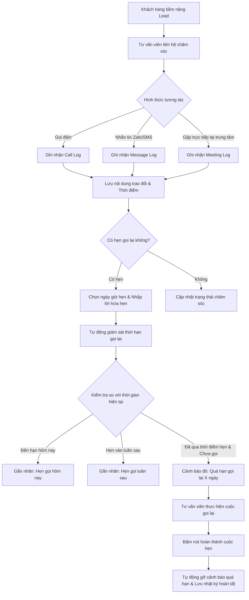

# Hệ Thống Quản Lý Đào Tạo (Training Management System - TMS)

## Phân Hệ Quản Lý Lead: Nhật Ký Chăm Sóc & Đặt Lịch Nhắc Gọi Lại (Jira KN-122)

> **Nhánh phát triển (Feature Branch):** `feature/KN_122`  
> **Phiên bản:** 1.3.0 (Sprint 3)  
> **Người thực hiện (Assignee):** Minh Quân (`minhquan247` / `dtc245200761@ictu.edu.vn`)  
> **Vai trò nghiệp vụ:** Tư vấn tuyển sinh (`usr_admissions`)  
> **Mã công việc Jira:** `KN-122` (KN Sprint 3 - Ước lượng: 3 Story Points)

---

## 1. Giới Thiệu Tổng Quan & Yêu Cầu Nghiệp Vụ (User Story)

Phân hệ Quản lý Lead trong Hệ thống Đào tạo TMS được xây dựng nhằm hỗ trợ Cán bộ Tư vấn Tuyển sinh theo dõi, chăm sóc và chuyển đổi học viên tiềm năng một cách có hệ thống, xuyên suốt và minh bạch.

### 1.1. Nội dung User Story (Jira KN-122)
> *"Là Tư vấn tuyển sinh, tôi muốn ghi nhật ký chăm sóc và đặt lịch nhắc gọi lại, để không quên lời hứa gọi lại cho khách vào tuần sau."*

### 1.2. Ba Tiêu Chí Nghiệm Thu Cốt Lõi (Acceptance Criteria)
1. **Ghi nhận tương tác đầy đủ:** Mỗi lần tương tác với khách hàng phải ghi nhận rõ 3 yếu tố: **loại hình** (gọi điện, nhắn tin, gặp trực tiếp), **nội dung chi tiết**, và **thời điểm tương tác** (ngày giờ chính xác).
2. **Đặt lịch nhắc gọi lại:** Tư vấn viên có thể đặt lịch hẹn gọi lại vào một thời điểm cụ thể trong tương lai kèm ghi chú lời hẹn (đặc biệt là lời hứa gọi lại vào tuần sau khi khách hàng hoàn thành thi cử hoặc sắp xếp xong công việc).
3. **Đánh dấu nổi bật hồ sơ quá hạn:** Các lead có lịch hẹn gọi lại đã quá hạn (`nextCallbackDate < now` và chưa hoàn tất) phải được hệ thống tự động phát hiện, tính số ngày trễ hạn, gắn nhãn cảnh báo đỏ nổi bật trên giao diện và cung cấp bộ lọc chuyên biệt để xử lý ngay.

---

## 2. Bối Cảnh Thực Tế & Vấn Đề Giải Quyết

Trong quy trình tư vấn tuyển sinh tại các trung tâm đào tạo, việc theo dõi khách hàng thường gặp các vấn đề nghiêm trọng:

- **Quên lời hứa gọi lại:** Khách hàng tiềm năng thường đang trong giai đoạn bận thi học kỳ, đi công tác hoặc cần thời gian thảo luận với gia đình và dặn *"tuần sau hãy gọi lại"*. Nếu không có lịch nhắc tự động, tư vấn viên rất dễ quên lời hẹn, làm mất niềm tin và giảm mạnh tỷ lệ chuyển đổi.
- **Phân tán lịch sử trao đổi:** Thông tin trao đổi qua các kênh khác nhau (gọi hotline, nhắn Zalo, gặp trực tiếp tại văn phòng) không được lưu vết tập trung, dẫn đến việc tư vấn viên sau không nắm được những gì tư vấn viên trước đã trao đổi.
- **Không đo lường được hồ sơ trễ hạn:** Quản lý và tư vấn viên không có số liệu tổng hợp về các cuộc hẹn bị bỏ lỡ, không biết có bao nhiêu khách hàng đang bị trễ hẹn gọi lại và trễ bao nhiêu ngày.

Giải pháp **KN-122** giải quyết triệt để các vấn đề trên thông qua cơ chế tự động hóa theo dõi hạn gọi lại, cảnh báo đa tầng và giao diện trực quan hỗ trợ thao tác nhanh.

---

## 3. Kiến Trúc Luồng Nghiệp Vụ (Process Workflow)



---

## 4. Thiết Kế Cơ Sở Dữ Liệu & Cấu Trúc Dữ Liệu

### 4.1. Cấu Trúc Bản Ghi Nhật Ký Chăm Sóc (`CareLog`)

Mỗi tương tác chăm sóc được lưu thành một bản ghi độc lập trong mảng `careLogs` của hồ sơ Lead:

```typescript
interface CareLog {
    id: string;                     // Khóa chính bản ghi (vd: "care_1792073175790_abc12")
    type: "call" | "message" | "meeting"; // Loại hình chuẩn hóa
    typeLabel: string;              // Nhãn tiếng Việt: "Gọi điện", "Nhắn tin", "Gặp trực tiếp"
    content: string;                // Nội dung chi tiết cuộc trao đổi
    notes: string;                  // Ghi chú (tương thích ngược)
    interactedAt: string;           // Thời điểm tương tác chuẩn ISO 8601
    timestamp: string;              // Timestamp tương thích KN-76
    counselorId: string;            // Mã định danh tư vấn viên phụ trách
    counselorName: string;          // Họ tên tư vấn viên
    result?: string;                // Kết quả: "Quan tâm cao", "Hẹn tư vấn lại", "Sắp đăng ký"...
    callbackDate?: string | null;   // Thời điểm hẹn gọi lại kế tiếp (ISO 8601)
    callbackNote?: string;          // Ghi chú nội dung lời hứa hẹn gọi lại
    callbackStatus?: "none" | "pending" | "completed"; // Trạng thái lịch hẹn
    completedAt?: string;           // Thời điểm hoàn thành cuộc gọi nhắc
    completedBy?: string;           // Tên người đánh dấu hoàn tất
}
```

### 4.2. Các Trường Thuộc Tính Đặt Lịch Nhắc Trên Đối Tượng Lead

```typescript
interface Lead {
    id: string;
    code: string;                     // Mã hồ sơ (vd: "LD-202610-020")
    fullName: string;
    phone: string;
    email: string;
    course: string;
    status: string;                   // "Mới", "Đang tư vấn", "Đã ghi danh", "Không liên lạc được", "Hủy"
    source: string;
    assignedTo: string;
    assignedToName: string;
    
    // KN-122: Quản lý lịch nhắc gọi lại & Cảnh báo quá hạn
    nextCallbackDate: string | null;  // Thời điểm hẹn gọi lại kế tiếp
    callbackNote: string;             // Nội dung lời hứa hẹn gọi lại
    callbackStatus: "none" | "pending" | "completed"; // Trạng thái lịch hẹn
    isOverdue: boolean;               // Cờ tự động: true khi nextCallbackDate < now và pending
    overdueDays: number;              // Số ngày đã quá hạn gọi lại
    callbackUrgency: "overdue" | "today" | "next_week" | "future" | "none"; // Mức độ ưu tiên
    
    careLogs: CareLog[];              // Danh sách toàn bộ lịch sử chăm sóc
    consultationHistory: any[];       // Danh sách tương thích ngược KN-76
}
```

---

## 5. Danh Mục RESTful API Endpoints Triển Khai

| STT | Phương thức | Đường dẫn Endpoint | Phân quyền (RBAC) | Mô tả chi tiết chức năng |
|:---:|:---:|:---|:---:|:---|
| 1 | `POST` | `/api/leads/:id/care-logs` | `admissions`, `training_manager`, `administrator` | **Ghi nhận tương tác chăm sóc mới:** Nhận loại hình (`call`, `message`, `meeting`), nội dung, thời điểm tương tác và thiết lập lịch nhắc gọi lại. |
| 2 | `GET` | `/api/leads/:id/care-logs` | `admissions`, `training_manager`, `administrator` | **Lấy danh sách nhật ký chăm sóc:** Trả về toàn bộ lịch sử tương tác chăm sóc của Lead sắp xếp theo thứ tự mới nhất lên đầu. |
| 3 | `POST` / `PATCH` | `/api/leads/:id/callbacks/complete` | `admissions`, `training_manager`, `administrator` | **Hoàn tất lịch nhắc gọi lại:** Chuyển trạng thái lịch hẹn sang `completed`, tự động xóa cảnh báo `isOverdue` và gỡ nhãn quá hạn. |
| 4 | `GET` | `/api/leads/reminders/summary` | `admissions`, `training_manager`, `administrator` | **Thống kê tổng hợp lịch nhắc:** Cung cấp số lượng lead quá hạn (`overdueCount`), cần gọi hôm nay (`todayCount`), hẹn gọi tuần sau (`nextWeekCount`). |
| 5 | `GET` | `/api/leads` *(nâng cấp)* | `admissions`, `training_manager`, `administrator` | **Lọc danh sách Lead nâng cao:** Bổ sung tham số `callbackFilter` (`overdue`, `today`, `next_week`, `pending`, `completed`) và `interactionType` (`call`, `message`, `meeting`). |

---

## 6. Chi Tiết Request & Response Mẫu Của API

### 6.1. Ghi nhận tương tác và đặt lịch nhắc gọi lại vào tuần sau

- **Endpoint:** `POST /api/leads/lead_kn122_002/care-logs`
- **Headers:** `Authorization: Bearer <token>`, `Content-Type: application/json`
- **Request Body:**
```json
{
  "type": "gọi",
  "content": "Khách đang trong tuần thi kết thúc học phần, hứa gọi lại vào tuần sau để chốt lịch khai giảng",
  "interactedAt": "2026-10-15T09:30:00.000Z",
  "callbackDate": "2026-10-22T09:30:00.000Z",
  "callbackNote": "Khách dặn tuần sau gọi lại sau khi thi học kỳ xong để chốt lịch khai giảng",
  "newStatus": "Đang tư vấn"
}
```

- **Response (HTTP 201 Created):**
```json
{
  "success": true,
  "message": "Đã lưu nhật ký chăm sóc và đặt lịch nhắc thành công!",
  "log": {
    "id": "care_1792073175790_x81k2",
    "type": "call",
    "typeLabel": "Gọi điện",
    "content": "Khách đang trong tuần thi kết thúc học phần, hứa gọi lại vào tuần sau để chốt lịch khai giảng",
    "interactedAt": "2026-10-15T09:30:00.000Z",
    "counselorId": "usr_admissions",
    "counselorName": "Minh Quân",
    "callbackDate": "2026-10-22T09:30:00.000Z",
    "callbackNote": "Khách dặn tuần sau gọi lại sau khi thi học kỳ xong để chốt lịch khai giảng",
    "callbackStatus": "pending"
  },
  "lead": {
    "id": "lead_kn122_002",
    "code": "LD-202610-021",
    "fullName": "Hoàng Mai Linh",
    "status": "Đang tư vấn",
    "nextCallbackDate": "2026-10-22T09:30:00.000Z",
    "callbackNote": "Khách dặn tuần sau gọi lại sau khi thi học kỳ xong để chốt lịch khai giảng",
    "callbackStatus": "pending",
    "isOverdue": false,
    "overdueDays": 0,
    "callbackUrgency": "next_week"
  }
}
```

### 6.2. Hoàn thành cuộc gọi hẹn lại

- **Endpoint:** `POST /api/leads/lead_kn122_001/callbacks/complete`
- **Request Body:**
```json
{
  "note": "Đã gọi lại lúc 14:00, phụ huynh đồng ý ghi danh khóa học Web Fullstack"
}
```

- **Response (HTTP 200 OK):**
```json
{
  "success": true,
  "message": "Đã đánh dấu hoàn tất cuộc gọi hẹn lại thành công!",
  "lead": {
    "id": "lead_kn122_001",
    "code": "LD-202610-020",
    "fullName": "Phan Đình Trọng",
    "callbackStatus": "completed",
    "isOverdue": false,
    "overdueDays": 0,
    "callbackUrgency": "none"
  }
}
```

---

## 7. Kiến Trúc Giao Diện Người Dùng (UI/UX)

Giao diện quản trị tuyển sinh được nâng cấp đồng bộ tại [`LeadManagement.html`](file:///c:/Users/Administrator/Downloads/minhquan_ttcs/LeadManagement.html) và [`frontend/LeadManagement.html`](file:///c:/Users/Administrator/Downloads/minhquan_ttcs/frontend/LeadManagement.html):

### 7.1. Hệ thống Thẻ Chỉ Số KPI (Dashboard Cards)
- **Thẻ Cảnh Báo Quá Hạn Gọi Lại:** Nổi bật với viền đỏ và hiệu ứng nhấp nháy, hiển thị số lượng lead đang trễ hẹn. Nhấp vào thẻ sẽ tự động lọc ngay danh sách các lead quá hạn cần ưu tiên gọi lại.
- **Thẻ Cần Gọi Hôm Nay:** Hiển thị các lịch hẹn trong ngày để tư vấn viên chủ động liên hệ.
- **Thẻ Hẹn Gọi Tuần Sau:** Đếm số lượng khách hàng đã hứa gọi lại vào tuần sau, giúp chuẩn bị kế hoạch tiếp cận chu đáo.

### 7.2. Thanh Lọc Nhanh Một Chạm (Quick Filter Pills)
Bao gồm các nút lọc tiện lợi:
- `Tất cả hồ sơ`
- `⚠️ Quá hạn gọi lại`
- `🔔 Cần gọi hôm nay`
- `📅 Hẹn gọi tuần sau`
- `⭐ Trao đổi từ tháng trước` (kế thừa KN-76)

### 7.3. Đánh Dấu Nổi Bật Dòng Quá Hạn Trên Bảng Dữ Liệu
- Dòng hồ sơ quá hạn có viền đỏ bên trái (`border-left: 4px solid #ef4444`) và nền hồng nhạt cảnh báo.
- Cột lịch hẹn hiển thị nhãn: `⚠️ QUÁ HẠN X NGÀY` kèm trích đoạn nội dung lời hứa hẹn.
- Nút bấm nhanh `✔ Đã gọi` cho phép đánh dấu hoàn thành chỉ với 1 thao tác mà không cần mở form.

### 7.4. Hộp Thoại Chăm Sóc & Đặt Lịch Hẹn (`#care-modal`)
- **Bộ chọn trực quan 3 loại hình:** Nút bấm riêng biệt cho **Gọi điện**, **Nhắn tin (Zalo/SMS)**, **Gặp trực tiếp**.
- **Chọn thời điểm tương tác:** Trường ngày giờ linh hoạt kèm nút chọn nhanh "Bây giờ".
- **Khung đặt lịch nhắc gọi lại:**
  - Công tắc bật/tắt nhắc hẹn.
  - Các nút chọn nhanh: `Ngày mai`, `3 ngày tới`, `⭐ Tuần sau (+7 ngày)`, `Tháng sau`.
  - Trường ngày giờ hẹn gọi lại và ô nhập ghi chú lời hứa hẹn với khách.
- **Dòng thời gian tương tác (Timeline):** Hiển thị trực quan toàn bộ các lần chăm sóc trước đây, sắp xếp mới nhất lên đầu kèm thông tin người thực hiện và lời hẹn đã giao ước.

---

## 8. Ma Trận Phân Quyền Truy Cập (RBAC Matrix)

| Vai trò nghiệp vụ | Mã vai trò | Quyền xem danh sách Lead | Quyền ghi nhật ký chăm sóc | Quyền đặt lịch nhắc gọi lại | Quyền hoàn tất lịch hẹn |
|---|:---:|:---:|:---:|:---:|:---:|
| **Tư vấn tuyển sinh** | `admissions` | Cho phép | Cho phép | Cho phép | Cho phép |
| **Quản trị hệ thống** | `administrator` | Cho phép | Cho phép | Cho phép | Toàn quyền |
| **Quản lý đào tạo** | `training_manager` | Cho phép | Cho phép | Cho phép | Cho phép |
| **Kế toán đào tạo** | `accountant` | Xem hồ sơ ghi danh | Bị chặn (403) | Bị chặn (403) | Bị chặn (403) |
| **Giảng viên** | `instructor` | Bị chặn (403) | Bị chặn (403) | Bị chặn (403) | Bị chặn (403) |
| **Trợ giảng** | `teaching_assistant` | Bị chặn (403) | Bị chặn (403) | Bị chặn (403) | Bị chặn (403) |
| **Học viên** | `student` | Bị chặn (403) | Bị chặn (403) | Bị chặn (403) | Bị chặn (403) |
| **Khách vãng lai** | `visitor` | Bị chặn (403) | Bị chặn (403) | Bị chặn (403) | Bị chặn (403) |

---

## 9. Danh Sách Tài Khoản Kiểm Thử Nghiệm Thu (Demo Accounts)

| STT | Vai trò nghiệp vụ | Email đăng nhập | Mật khẩu | Trang kiểm thử tương ứng |
|:---:|:---|:---|:---:|:---|
| 1 | **Tư vấn tuyển sinh (Chính)** | `admissions@tms.edu.vn` | `admissions123` | **[`/LeadManagement.html`](file:///c:/Users/Administrator/Downloads/minhquan_ttcs/LeadManagement.html)** *(Trọng tâm KN-122)* |
| 2 | **Quản trị hệ thống** | `admin@tms.edu.vn` | `admin123` | [`/UserManagement.html`](file:///c:/Users/Administrator/Downloads/minhquan_ttcs/UserManagement.html) |
| 3 | **Quản lý đào tạo** | `manager@tms.edu.vn` | `manager123` | [`/SubjectManagement.html`](file:///c:/Users/Administrator/Downloads/minhquan_ttcs/SubjectManagement.html) |
| 4 | **Giảng viên** | `teacher@tms.edu.vn` | `teacher123` | [`/Index.html?role=instructor`](file:///c:/Users/Administrator/Downloads/minhquan_ttcs/frontend/Index.html) |
| 5 | **Trợ giảng** | `ta@tms.edu.vn` | `ta123456` | [`/Index.html?role=teaching_assistant`](file:///c:/Users/Administrator/Downloads/minhquan_ttcs/frontend/Index.html) |
| 6 | **Học viên** | `student@tms.edu.vn` | `student123` | [`/Index.html?role=student`](file:///c:/Users/Administrator/Downloads/minhquan_ttcs/frontend/Index.html) |
| 7 | **Kế toán đào tạo** | `accountant@tms.edu.vn` | `accountant123` | [`/Index.html?role=accountant`](file:///c:/Users/Administrator/Downloads/minhquan_ttcs/frontend/Index.html) |
| 8 | **Khách vãng lai** | `visitor@tms.edu.vn` | `visitor123` | [`/LeadForm.html`](file:///c:/Users/Administrator/Downloads/minhquan_ttcs/LeadForm.html) |

---

## 10. Báo Cáo Kiểm Thử Tự Động (Automated Testing Suite)

Bộ kiểm thử tự động được xây dựng độc lập tại [`backend/test/lead_care_log_kn122.test.js`](file:///c:/Users/Administrator/Downloads/minhquan_ttcs/backend/test/lead_care_log_kn122.test.js), bao phủ đầy đủ 6 nhóm tiêu chí nghiệm thu của Jira KN-122:

```bash
npm run test:kn122
```

### Bảng Kết Quả Kiểm Thử Thực Tế:

| Nhóm kiểm thử | Tiêu chí đánh giá chi tiết | Kết quả |
|---|---|:---:|
| **1. Ghi nhật ký đa kênh** | Kiểm tra ghi nhận loại Gọi điện, Nhắn tin, Gặp trực tiếp kèm nội dung, thời điểm; validate bắt lỗi khi thiếu trường | **PASS (100%)** |
| **2. Đặt lịch nhắc gọi lại** | Kiểm tra đặt lịch hẹn gọi lại vào tuần sau (+7 ngày), ghi chú lời hứa hẹn, tra cứu chi tiết và lấy danh sách care logs | **PASS (100%)** |
| **3. Cảnh báo quá hạn** | Kiểm tra tự động gắn cờ `isOverdue=true`, tính số ngày quá hạn, lọc theo `overdue`, `today`, `next_week` và `interactionType` | **PASS (100%)** |
| **4. Hoàn tất cuộc gọi hẹn** | Kiểm tra gọi API complete callback, chuyển trạng thái sang `completed`, xóa cờ quá hạn và xóa khỏi bộ lọc quá hạn | **PASS (100%)** |
| **5. Thống kê KPI nhắc hẹn** | Kiểm tra API `/api/leads/reminders/summary` tính toán chính xác số lượng overdue, today, next_week | **PASS (100%)** |
| **6. Phân quyền truy cập RBAC** | Kiểm tra chặn học viên (403), chặn người lạ không token (401), cho phép quản trị viên và quản lý đào tạo | **PASS (100%)** |

---

## 11. Hướng Dẫn Cài Đặt & Khởi Chạy (Getting Started)

### Yêu cầu môi trường
- Node.js phiên bản 18.x hoặc cao hơn
- Trình quản lý gói npm phiên bản 9.x hoặc cao hơn

### Các lệnh thực thi
```bash
# 1. Cài đặt các gói phụ thuộc
npm install

# 2. Khởi động máy chủ backend
npm start

# 3. Chạy toàn bộ bài kiểm thử tự động của chức năng KN-122
npm run test:kn122

# 4. Mở trình duyệt và truy cập màn hình Quản lý Lead
# URL: http://localhost:3000/LeadManagement.html
```

---

## 12. Danh Mục Tệp Mã Nguồn Triển Khai

- **Báo cáo nghiệm thu kỹ thuật chi tiết:** [`KN_122.md`](file:///c:/Users/Administrator/Downloads/minhquan_ttcs/KN_122.md)
- **Bộ kiểm thử tự động toàn diện:** [`backend/test/lead_care_log_kn122.test.js`](file:///c:/Users/Administrator/Downloads/minhquan_ttcs/backend/test/lead_care_log_kn122.test.js)
- **Tầng dịch vụ nghiệp vụ (Business Service):** [`backend/leadService.js`](file:///c:/Users/Administrator/Downloads/minhquan_ttcs/backend/leadService.js)
- **Tầng định tuyến API (Express Router & Middleware):** [`backend/server.js`](file:///c:/Users/Administrator/Downloads/minhquan_ttcs/backend/server.js)
- **Giao diện Quản trị Tuyển sinh:** [`LeadManagement.html`](file:///c:/Users/Administrator/Downloads/minhquan_ttcs/LeadManagement.html) và [`frontend/LeadManagement.html`](file:///c:/Users/Administrator/Downloads/minhquan_ttcs/frontend/LeadManagement.html)
- **Cấu hình kịch bản kiểm thử:** [`package.json`](file:///c:/Users/Administrator/Downloads/minhquan_ttcs/package.json) và [`backend/package.json`](file:///c:/Users/Administrator/Downloads/minhquan_ttcs/backend/package.json)