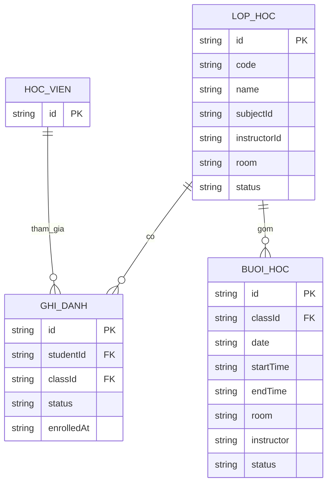

# KN-256: Mô hình dữ liệu lịch học cá nhân của học viên

## 1. Mục tiêu

Xác định cấu trúc và mối liên hệ giữa học viên, ghi danh,
lớp học và buổi học để học viên chỉ xem được lịch của lớp
mình tham gia.

## 2. Sơ đồ quan hệ logic

PK và FK trong sơ đồ biểu thị quan hệ logic giữa các đối tượng, không khẳng định hệ thống sử dụng khóa ngoại SQL vật lý.

## 3. Cấu trúc dữ liệu hiện tại

### 3.1. Học viên

- Nguồn: `backend/authService.js`
- Khóa định danh: `id`
- Liên kết với ghi danh thông qua `studentId`.

### 3.2. Ghi danh

Nguồn: `backend/enrollmentService.js`

Các trường dữ liệu:

- `id`: Mã ghi danh.
- `studentId`: Mã học viên.
- `classId`: Mã lớp học.
- `classCode`, `className`: Thông tin lớp học.
- `studentName`, `studentEmail`: Thông tin học viên.
- `enrolledAt`, `enrolledBy`: Thông tin ghi danh.
- `status`: Trạng thái ghi danh.

### 3.3. Lớp học

Nguồn: `backend/scheduleService.js`, biến `activeClasses`.

Các trường chính:
- `id`, `code`, `name`
- `subjectId`, `subjectName`, `programId`
- `instructorId`, `instructor`
- `room`, `defaultShift`, `status`
- `studentIds` (nếu có)

### 3.4. Buổi học

Nguồn: `backend/scheduleService.js`, biến `classSchedules`.

Các trường chính:
- `id`, `classId`, `classCode`, `className`
- `sessionNumber`, `totalSessions`
- `date`, `startTime`, `endTime`, `shift`
- `room`, `instructor`
- `lessonNumber`, `lessonTopic`, `lessonType`
- `status`, `note`, `version`

## 4. Quy tắc liên kết

1. Một học viên có thể tham gia nhiều lớp.
2. Một lớp có thể có nhiều học viên.
3. Một lớp có thể có nhiều buổi học.
4. Buổi học liên kết với lớp thông qua `classId`.
5. Phòng học được lưu bằng trường `room`, chưa có bảng riêng.

## 5. Quy tắc truy xuất và phân quyền

- `canSeeClass()` kiểm tra quyền xem lớp.
- `canSeeSession()` kiểm tra quyền xem buổi học.
- Học viên chỉ được xem lịch của lớp mình tham gia.
- Backend kiểm tra quyền, không chỉ dựa vào giao diện.
- `/api/schedules`: Lấy các buổi học được phép xem.
- `/api/schedules/next`: Lấy buổi học kế tiếp.
- `/api/schedules/my-week`: Lấy lịch cá nhân tuần hiện tại.

## 6. Ghi chú triển khai

- Tài liệu mô tả mô hình dữ liệu logic đang sử dụng.
- Không tạo thêm bảng dữ liệu mới.
- Dữ liệu 12 buổi tháng 3/2026 là dữ liệu mẫu Backend.
- Cần xác định thêm quy tắc xử lý ghi danh đã hủy nếu nghiệp vụ yêu cầu.
