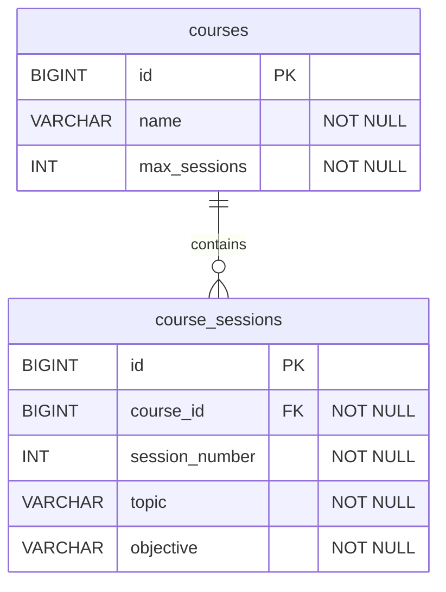

# KN-72 — Quản lý buổi học theo môn

## Mô hình dữ liệu

- Mỗi môn học có thể có nhiều buổi học; mỗi buổi thuộc về đúng một môn.
- `course_sessions` có ràng buộc duy nhất trên `(course_id, session_number)`.
- Số buổi tối đa được lưu ở `courses.max_sessions`; API từ chối thêm hoặc nhân bản nếu tổng số buổi vượt giới hạn.
- Schema được ánh xạ từ entity JPA; `spring.jpa.hibernate.ddl-auto=update` cập nhật schema khi ứng dụng kết nối cơ sở dữ liệu.

## API

| Method | Endpoint | Chức năng |
|---|---|---|
| `GET` | `/api/courses` | Liệt kê môn học |
| `POST` | `/api/courses` | Tạo môn học với tên và số buổi tối đa |
| `GET` | `/api/courses/{courseId}/sessions` | Liệt kê buổi học theo số thứ tự |
| `POST` | `/api/courses/{courseId}/sessions` | Khai báo buổi học; từ chối số thứ tự trùng hoặc vượt giới hạn |
| `POST` | `/api/courses/{targetId}/sessions/copy` | Nhân bản các buổi từ `sourceCourseId` sang môn đích |

## Kiểm thử

Chạy `.\mvnw.cmd test` từ thư mục gốc. Unit test controller dùng mock repository nên không cần MySQL; kiểm thử tích hợp với cơ sở dữ liệu thực cần cấu hình datasource riêng.
